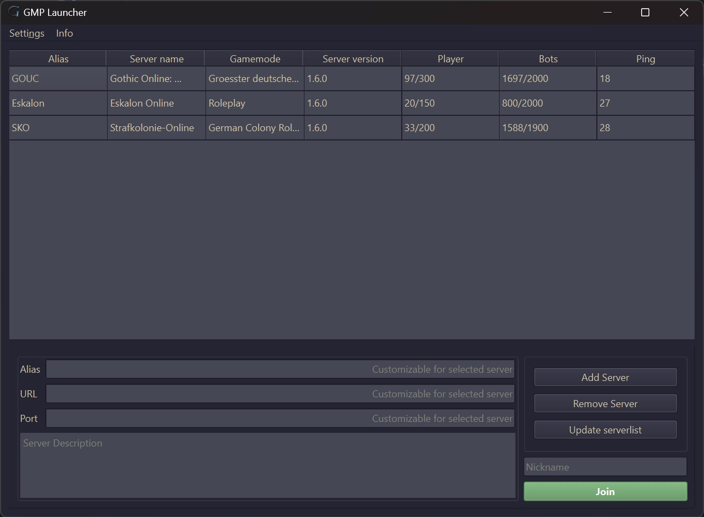

# Gothic Multiplayer Launcher (GML)
___

# Getting started

## Windows

- [Visual Studio (>= 2022 17.6)](https://visualstudio.microsoft.com/vs/) with C++ Toolchain and the English language pack
- [vcpkg](https://github.com/microsoft/vcpkg?tab=readme-ov-file#get-started) *(optional)*

Qt6 can be built with vcpkg (takes some time) or [installed](https://www.qt.io/product/qt6) as a pre-built library.

### Build

```bash
cmake -B build --preset windows-x86-release
# Or if you have Qt installed as a pre-built library, pass -DCMAKE_PREFIX_PATH=C:/Qt/<version>/<compiler>/lib/cmake/Qt6
cmake --build build
cmake --install build --prefix dist
```

After build go to the dist folder and add `gmp/gmp.dll` into it.

## Debian/Ubuntu

```bash
sudo apt install cmake build-essential qt6-base-dev libssl-dev
```

### Build

```bash
cmake -B build -DCMAKE_BUILD_TYPE=Release
cmake --build build
cmake --install build --prefix dist
```

Go to the dist folder and add `gmp/gmp.dll` into it.

### Run

GML starts Steam's Gothic II (Gothic II: Gold Classic) with the Proton build Steam uses for it.
Start the game from Steam once first, so its Proton prefix exists.

Use [GE-Proton](https://github.com/GloriousEggroll/proton-ge-custom) for Gothic II. With Valve's
Proton the music is missing until DirectMusic is installed into the game's prefix, once:
`protontricks 39510 directmusic`.

```bash
sudo apt install libqt6widgets6 python3   # Fedora: qt6-qtbase-gui python3
./gml
```

In GML, set the Gothic path under Settings => Options as a Windows path on wine's `Z:` drive, e.g.
`Z:\home\<user>\.local\share\Steam\steamapps\common\Gothic II`.

- Install [GD3D11](https://github.com/kirides/GD3D11/releases) into the game's `system` folder:
  without it, Alt+Tab crashes the game.
- `GMP_PROTON=<Proton directory> ./gml` overrides the Proton build.
___
# Preview

___
# License
[MIT](LICENSE)
